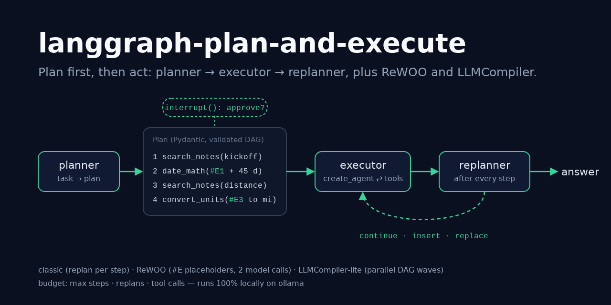
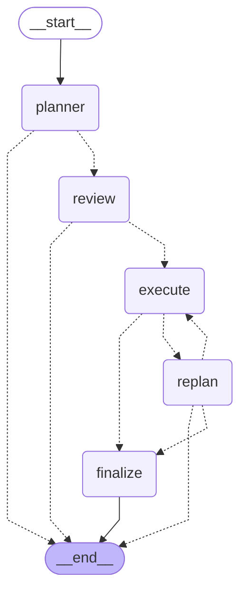
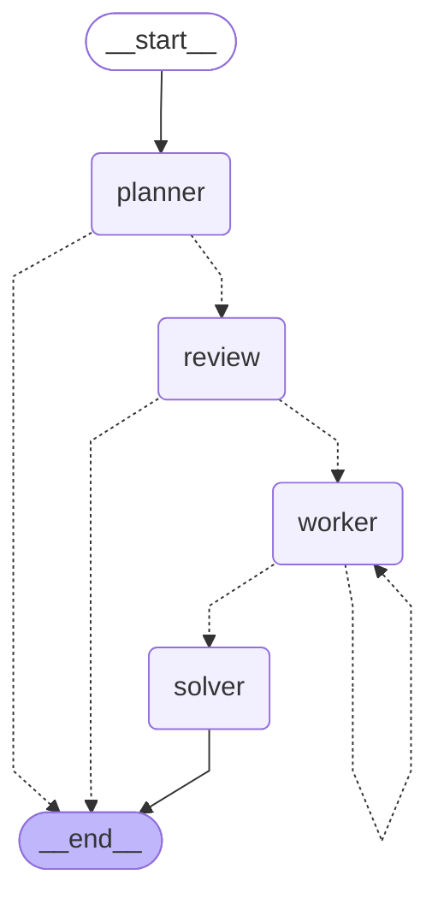
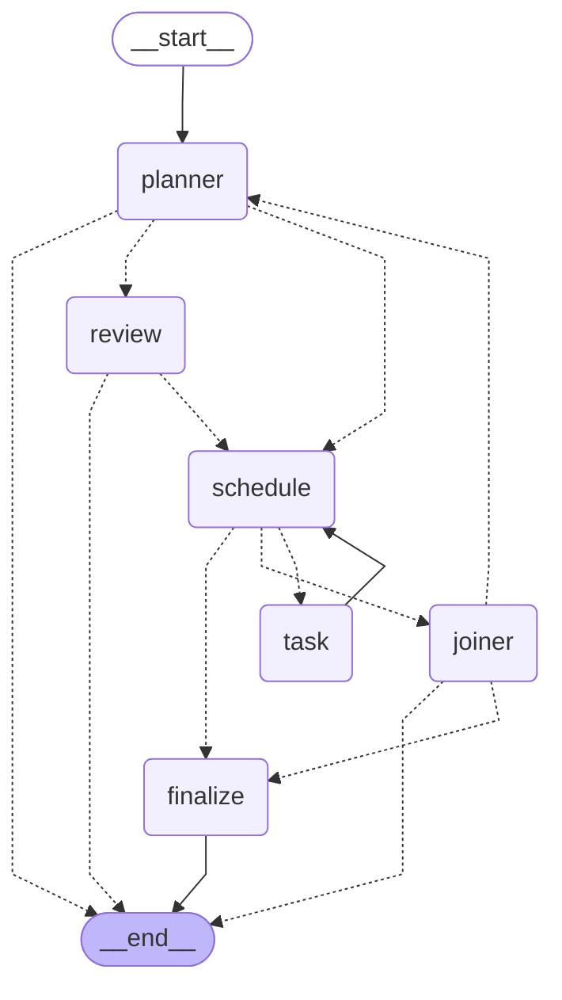

# langgraph-plan-and-execute

> The planning agent architecture in LangGraph, three ways. A planner writes a validated
> Pydantic plan, a `create_agent` ReAct executor runs it one step at a time, and a
> replanner finishes, edits the plan or inserts recovery steps, all under a hard budget.
> Next to it: ReWOO (`#E` placeholders, two model calls per task) and LLMCompiler-lite
> (independent steps run in parallel DAG waves). A human can approve or edit the plan
> through `interrupt()` before anything runs.

[](https://github.com/MartinCastroAlvarez/langgraph-plan-and-execute/actions/workflows/ci.yml)
[](LICENSE)
[](pyproject.toml)
[](https://github.com/langchain-ai/langgraph)
[](pyproject.toml)



**Runs 100% locally, no paid APIs required.** The default model is an open-weight model
on [ollama](https://ollama.com) (`qwen3:4b`) through `langchain-ollama`. The four tools
are local and deterministic: a calculator (an AST walker, no `eval`), a unit converter,
date arithmetic, and BM25 search over a bundled folder of notes. Anthropic is an optional
adapter you can switch on with your own key. The tests, the examples and the benchmark
use a fake chat model and need no model, no key and no network.

## Why

- **ReAct thinks one tool call at a time.** On a task like "what weekday is the launch,
  and how far is the flight in miles?" it re-reads the whole history before every call
  and can lose the thread. A plan makes the strategy explicit, reviewable and testable
  before any tool runs.
- **Plans go wrong, so someone has to replan.** A step fails (the model asked for a unit
  that doesn't exist), and the replanner inserts a recovery step instead of giving up.
  The tests pin that behaviour down.
- **Planning has a price, and the variants pay it differently.** Classic replans after
  every step: 16 model calls for a 5-step task. ReWOO plans once and solves once: 2 calls,
  but it can't react to a failure. LLMCompiler-lite also uses 2 calls and runs independent
  steps in parallel. The [benchmark](#benchmark-three-variants-side-by-side) measures all
  three.
- **Autonomy needs a ceiling and a brake.** A plan-level budget (steps, replans, tool
  calls) always ends the run with a partial answer instead of a loop. `interrupt()` lets
  a person approve, edit or reject the plan, and a SQLite checkpointer keeps the pause
  alive across processes.

## Quickstart

```bash
pip install "langgraph-plan-and-execute @ git+https://github.com/MartinCastroAlvarez/langgraph-plan-and-execute"
ollama pull qwen3:4b
python -m plan_and_execute "What weekday is the Project Atlas launch, and how many miles is the Berlin to Lisbon flight?"
python -m plan_and_execute --provider fake --variant all "How cold is the sample freezer in Fahrenheit?"   # offline
python -m plan_and_execute.bench                                                                       # the comparison table
```

`--variant classic|rewoo|compiler|all` picks the graph, `--approve` pauses for plan
review, and `--mermaid <variant>` prints a graph. `python -m examples.quickstart` runs
all three variants and an approve-and-edit review offline.

```text
$ python -m plan_and_execute --provider fake --variant classic "How cold is the sample freezer in Fahrenheit?"
[  0.002s] plan           round=1 steps=['1. search_notes(sample freezer setpoint)', '2. convert_units(#E1 to degrees) <- [1]']
[  0.005s] step           id=1 goal='Find the freezer setpoint'
[  0.008s] step_done      id=1 ok=True output='[lab] Sample freezer setpoint: -80 °C'
[  0.011s] step           id=2 goal='Convert the setpoint'
[  0.015s] step_done      id=2 ok=False output="FAILED: error: unknown target unit 'degrees'"
[  0.016s] insert         steps=[3]
[  0.018s] step           id=3 goal='Convert the setpoint to Fahrenheit'
[  0.022s] step_done      id=3 ok=True output='-112 °F'
[  0.023s] finish

[classic] Sample freezer setpoint: -80 °C, which is -112 °F.
  status=done llm_calls=10 tool_calls=3 replans=1 seconds=0.028
```

That transcript is a real run with the **fake** model, whose plan for this task has a
deliberate mistake in step 2 (`degrees` is not a unit). The executor really calls the
converter, the converter really refuses, and the replanner inserts step 3. With ollama
the model writes its own plan and its own recovery.

## The plan

All three variants share one plan format, so one planner prompt, one parser and one
review step serve them all:

```python
class Step(BaseModel):
    id: int                                   # 1..99, unique
    goal: str                                 # what this step must achieve
    tool: Literal["calculator", "search_notes", "convert_units", "date_math"] | None
    input: str | None                         # tool input; "#E1" = the result of step 1
    success: str                              # how to tell the step worked
    depends_on: list[int]                     # #E references are added automatically

class Plan(BaseModel):
    steps: list[Step]                         # ids unique, dependencies known, no cycles
```

`parse_plan` takes the model's raw reply, strips `<think>` blocks, code fences and
surrounding prose, finds the first JSON value, and validates it. It also enforces the
budget's `max_steps` and, for ReWOO and the compiler, that every step has a tool and an
input. When validation fails, the planner gets the error back once and can fix its
plan; if it fails again, the run ends with status `failed` and no tool has run.

## The three variants

### 1. Classic plan-and-execute



- **`execute`** runs the next pending step with a ReAct agent from
  `langchain.agents.create_agent` (model ⇄ `ToolNode` over the four tools). It sees the
  task, the step and the results of the steps it depends on. A
  `ToolCallLimitMiddleware(run_limit=..., exit_behavior="end")` caps tool calls per step,
  and the limit shrinks as the task's tool budget runs out. A step fails when the agent
  answers `FAILED:` or nothing, or, for a step with a tool hint, when its last tool call
  errored or no tool call succeeded. A provider exception fails the step, not the run.
- **`replan`** runs after every step and returns JSON: `continue`, `finish` (with the
  answer), `insert` (recovery steps that run next) or `replace` (new remaining steps).
  The new plan is validated as a whole (done steps + new steps) before it's accepted.
  An invalid decision counts as `continue`, and once `max_replans` is used up, edits are
  refused.
- **`finalize`** writes an answer without a model call when the budget stops the run
  (`Stopped early (max_steps=2 reached). Found: ...`) or when the plan ran out without a
  `finish`.

### 2. ReWOO: plan once, observe never, solve once



The planner has to write every tool input up front, using evidence variables:

```text
1. search_notes  Project Atlas kickoff date
2. search_notes  Project Atlas launch after kickoff
3. date_math     #E1 + #E2
4. search_notes  Berlin to Lisbon flight distance
5. convert_units #E4 to mi
```

The `worker` runs the steps in dependency order with **no model call in between**. Each
`#E<n>` becomes the first line of step *n*'s result, without its `[note-id]` prefix,
so step 3 really runs `date_math("Project Atlas kickoff date: 2026-11-03 + Project
Atlas launch: 45 days after kickoff")`. Inside a calculator expression, `#E<n>` becomes
the first number of that line (`#E1 * #E2 * 4` → `85 * 6 * 4`). The tools are lenient
about surrounding text so this works without an extra LLM call to extract values. A
failed step skips every step that depends on it. The `solver` answers from the evidence.

### 3. LLMCompiler-lite: the plan is a DAG



`schedule` finds every step whose dependencies have all succeeded and fans them out with
`Send("task", ...)` in a single superstep, a *wave*. Results come back through the
`results` reducer (`Annotated[list, operator.add]`), and `schedule` runs again. For the
plan above the waves are `[[1, 2, 4], [3, 5]]`, and with 0.2 s tools the peak number of
tool calls in flight is 3 (both asserted in `tests/test_compiler.py`). Skips cascade: a
step after a failed or skipped step is skipped. The `joiner` then answers or asks for a
new plan, which goes back to the planner together with the previous results, at most
`max_replans` times.

*Lite* because tasks are dispatched in waves, so a ready task waits for the slowest
task of the previous wave, and the planner doesn't stream tasks while it is still
writing the plan. Full LLMCompiler does both.

All three graphs are `get_graph().draw_mermaid()` output, pasted unchanged
(`python -m plan_and_execute --mermaid <variant>`). The executor agent is
`--mermaid executor`.

## Human in the loop: approve, edit or reject the plan

With `approve_plan=True` (`--approve`, `PLAN_EXECUTE_APPROVE=1`), the `review` node calls
`interrupt()` before any tool runs, and you resume with `Command(resume=...)`:

```python
from langgraph.checkpoint.memory import InMemorySaver   # or AsyncSqliteSaver
from langgraph.types import Command

graph = build_graph("compiler", Settings(approve_plan=True), checkpointer=InMemorySaver())
config = {"configurable": {"thread_id": "t1"}}

paused = await graph.ainvoke({"task": task}, config)
plan = paused["__interrupt__"][0].value["steps"]          # show it to a person
plan[1]["input"] = "#E1 to F"                              # ...who fixes it
final = await graph.ainvoke(Command(resume={"action": "edit", "steps": plan}), config)
# or Command(resume={"action": "approve"}) / {"action": "reject", "reason": "..."}
```

- The resume value is validated by `interrupt(payload, response_schema=ReviewDecision)`.
  A malformed answer (unknown action, an edit without steps, a cycle, an unknown field)
  raises `ValidationError` to the caller. Nothing is saved, so the same interrupt can
  simply be answered again.
- A well-formed edit that breaks the budget or the variant's rules (too many steps, a
  ReWOO step without a tool) gets a second interrupt that carries the error. After three
  bad edits the plan is rejected.
- The pause is durable. `AsyncSqliteSaver` stores it, and a new process resumes it:

```bash
python -m plan_and_execute --variant compiler --approve --db runs.sqlite --thread t1 "..."   # prints the plan, exits
python -m plan_and_execute --variant compiler --db runs.sqlite --thread t1 --resume approve  # or reject, edit:plan.json
```

## Budget

| Limit | Default | Classic | ReWOO | Compiler |
| --- | ---: | --- | --- | --- |
| `max_steps` | 8 | plan length and steps executed | plan length | plan length |
| `max_replans` | 3 | `insert` / `replace` decisions | (never replans) | joiner re-plans |
| `max_tool_calls` | 12 | across all executor agents | worker stops | waves are truncated |
| `max_step_tool_calls` | 3 | `ToolCallLimitMiddleware` per step | n/a | n/a |

Hitting a limit sets `status="budget"` and a `stop_reason`, and the run still ends with
an answer: the solver's for ReWOO, otherwise `finalize`'s, built from whatever the steps
found. The graph's `recursion_limit` is derived from the budget, so the budget always
trips first.

## Benchmark: three variants side by side

`python -m plan_and_execute.bench` runs the real graphs, tools and notes search on three
tasks. Only the model is replaced, by `FakePlanModel` with **0.25 s per model call**,
and every tool call sleeps **0.1 s**. The numbers measure orchestration (round trips and
overlap), not one model's speed. Measured on 2026-10-24 on a shared 14-core Linux
container, Python 3.12.3, langgraph 1.2.17, langchain 1.4.7, median of 3 runs
([`docs/benchmark/results.json`](docs/benchmark/results.json)):

| Task | Variant | LLM calls | Tool calls | Replans | Wall clock (s) | Correct |
| --- | --- | ---: | ---: | ---: | ---: | --- |
| launch+flight (5 steps, 2 chains) | classic | 16 | 5 | 0 | 4.623 | yes |
| launch+flight (5 steps, 2 chains) | rewoo | 2 | 5 | 0 | 1.042 | yes |
| launch+flight (5 steps, 2 chains) | compiler | 2 | 5 | 0 | 0.736 | yes |
| per diem (3 steps) | classic | 10 | 3 | 0 | 2.869 | yes |
| per diem (3 steps) | rewoo | 2 | 3 | 0 | 0.825 | yes |
| per diem (3 steps) | compiler | 2 | 3 | 0 | 0.716 | yes |
| freezer (step fails) | classic | 10 | 3 | 1 | 2.866 | yes |
| freezer (step fails) | rewoo | 2 | 2 | 0 | 0.712 | no |
| freezer (step fails) | compiler | 4 | 4 | 1 | 1.436 | yes |

What the numbers say:

- **Classic costs `1 + 3N` model calls** for N steps (plan, then a tool call, an answer
  and a replan per step): 16 calls and 4.6 s for 5 steps. That buys a decision after
  every observation, which is how it fixes the freezer task with one inserted step.
- **ReWOO costs 2 calls whatever N is**, so it's 4.4x faster on the 5-step task. It's
  also blind: when step 2 fails, nothing can repair it, and the answer is only partial.
- **The compiler costs 2 calls plus 2 per re-plan**, and it overlaps independent tool
  calls: 5 sequential tool calls (0.5 s) become 2 waves (0.2 s). On failure it re-plans
  the whole thing (4 calls, 1.4 s), which is still half the classic cost here.
- Speed-ups grow with model latency. A local 4B model on a laptop GPU often takes 1-3 s
  per call, so classic's `1 + 3N` dominates everything else. Run the benchmark with
  `--latency` set to your own model's per-call time.

## When to use this pattern / trade-offs

Use planning when a task has **several dependent steps** that are known (or guessable)
up front: look something up, compute with it, convert it, compare. It also fits when
someone has to review what an agent will do before it does it. Skip it for one-shot
questions (a single tool call or plain ReAct is cheaper) and for open-ended exploration
where step *k* can't be guessed before seeing step *k-1* (ReAct adapts better).

| Variant | Pick it when | Cost |
| --- | --- | --- |
| Classic | steps can fail or surprise you; correctness beats latency | `1 + 3N` model calls; the slowest |
| ReWOO | tasks are routine and tool inputs are predictable; tokens are expensive | 2 calls, but no recovery: one bad step and the answer is partial |
| LLMCompiler-lite | the plan has independent branches (several lookups, then combine) | 2 calls + 2 per re-plan; recovery means re-planning everything |

| Gain | Cost |
| --- | --- |
| An explicit, reviewable plan (and a natural place for human approval) | The planner must guess the strategy before seeing any data |
| Budgets per plan instead of per call | Plans go stale: classic pays for a replan after every step |
| Smaller executor contexts (one step, its inputs) | The executor can't see the big picture, only its step |
| Parallel waves for free once dependencies are explicit | Placeholder substitution needs lenient tools or an extra extraction step |

## Configuration

| Variable | Default | Meaning |
| --- | --- | --- |
| `PLAN_EXECUTE_PROVIDER` | `ollama` | `ollama`, `anthropic` (optional extra + your key) or `fake` |
| `PLAN_EXECUTE_MODEL` | `qwen3:4b` / `claude-sonnet-5-5` | model id for the provider |
| `OLLAMA_HOST` | `http://127.0.0.1:11434` | must be loopback unless the next variable is `1` |
| `PLAN_EXECUTE_ALLOW_REMOTE_OLLAMA` | unset | `1` allows a non-loopback ollama |
| `PLAN_EXECUTE_TEMPERATURE` | `0` | sampling temperature |
| `PLAN_EXECUTE_MAX_STEPS` | `8` | steps per plan / steps executed |
| `PLAN_EXECUTE_MAX_REPLANS` | `3` | plan edits (classic) or re-plans (compiler) |
| `PLAN_EXECUTE_MAX_TOOL_CALLS` | `12` | tool calls per task |
| `PLAN_EXECUTE_MAX_STEP_TOOL_CALLS` | `3` | tool calls per classic step |
| `PLAN_EXECUTE_APPROVE` | unset | `1` pauses for plan review |
| `PLAN_EXECUTE_NOTES_DIR` | bundled notes | a folder of `.md`/`.txt` notes, one fact per bullet |
| `PLAN_EXECUTE_TODAY` | the real date | `YYYY-MM-DD` for the date tool |
| `PLAN_EXECUTE_FAKE_LATENCY` | `0` | seconds per call for the `fake` provider |
| `PLAN_EXECUTE_TOOL_LATENCY` | `0` | simulated seconds per tool call |

With ollama, the planner, replanner and joiner use the model in JSON mode
(`format="json"`), and the executor and solver use it as is. For Anthropic, run
`pip install "langgraph-plan-and-execute[anthropic] @ git+…"`, then set
`ANTHROPIC_API_KEY` and `PLAN_EXECUTE_PROVIDER=anthropic`. The project itself never
calls a hosted API. LangSmith tracing stays off unless you set `LANGSMITH_TRACING`.

## Testing

```bash
poetry install && poetry run pytest          # 149 tests, 98% coverage, ~4 s, offline
```

The tests drive the graphs with `FakePlanModel`, a real `BaseChatModel` that reads the
`Role:` line of each system prompt and answers like that node would. It can also be
scripted with canned replies or exceptions. One test drives ReWOO with LangChain's own
`GenericFakeChatModel`. The tests check control flow, not prose:

- **plan parsing and validation:** fenced or prose-wrapped JSON, `<think>` blocks,
  duplicate ids, unknown dependencies, cycles, self-references, budget caps, tool-less
  steps in ReWOO, the planner's single repair attempt;
- **replan triggers:** a failed step gets a recovery step inserted (classic), a `replace`
  drops the rest of the plan, invalid decisions fall back to `continue`, the joiner
  re-plans after a failure (compiler);
- **budgets:** `max_steps`, `max_tool_calls` and `max_replans` each end the run with
  `status="budget"` and a partial answer, in every variant where they apply;
- **ReWOO:** exactly two model calls, placeholders substituted literally (numbers in
  calculator expressions), failed steps skip their dependants;
- **DAG scheduling:** waves `[[1, 2, 4], [3, 5]]`, 3 tool calls in flight at once, the
  parallel run beats the sequential one on the wall clock, skips cascade;
- **interrupt/resume:** approval in every variant, edits and rejection, malformed answers
  raise `ValidationError` and leave the interrupt open, over-budget edits come back with
  the error, and a pause in one SQLite-backed graph is resumed by another;
- **security:** the calculator refuses names, attributes, calls outside an allowlist,
  huge powers and long inputs; the notes loader ignores symlinks, hidden files and files
  outside its root; `<data>` escaping; loopback-only ollama; an AST test bans
  `eval`/`exec`/`pickle`/`subprocess` and silenced findings in the package.

## Part of the series

| Repo | Framework | Architecture |
|---|---|---|
| [langgraph-parallel-agents](https://github.com/MartinCastroAlvarez/langgraph-parallel-agents) | LangGraph | Parallelization / map-reduce (fan-out, fan-in) |
| ✅ **langgraph-plan-and-execute** | LangGraph | Planning (plan → execute → replan) |
| [langgraph-reflection-agent](https://github.com/MartinCastroAlvarez/langgraph-reflection-agent) | LangGraph | Reflection (Reflexion: draft → critique → revise) |
| [langgraph-short-long-term-memory](https://github.com/MartinCastroAlvarez/langgraph-short-long-term-memory) | LangGraph | Memory: short-term (checkpointer) vs long-term (store) |
| [adk-sequential-pipeline](https://github.com/MartinCastroAlvarez/adk-sequential-pipeline) | Google ADK | Sequential pipeline + generator↔critic loop |
| [adk-vertex-memory-bank](https://github.com/MartinCastroAlvarez/adk-vertex-memory-bank) | Google ADK | Long-term memory (Vertex AI Memory Bank) |
| [adk-vertex-vector-search](https://github.com/MartinCastroAlvarez/adk-vertex-vector-search) | Google ADK | Agentic RAG (Vertex AI Vector Search) |
| [crewai-hierarchical-planning](https://github.com/MartinCastroAlvarez/crewai-hierarchical-planning) | CrewAI | Hierarchical / supervisor with planning |
| [langchain-tag-agent](https://github.com/MartinCastroAlvarez/langchain-tag-agent) | LangChain | Tool-using ReAct agent with Table-Augmented Generation (TAG) |
| [langsmith-agent-evals](https://github.com/MartinCastroAlvarez/langsmith-agent-evals) | LangSmith + LangGraph | Evaluation / observability, LLM-as-judge critic |
| [agentic-architectures](https://github.com/MartinCastroAlvarez/agentic-architectures) | framework-free | Catalog: ReAct, router, sequential, parallel, loop, reflection, critic, planning, supervisor, swarm/handoff, debate, human-in-the-loop, memory |
| [s3-agent-memory](https://github.com/MartinCastroAlvarez/s3-agent-memory) | LangGraph store | Agent memory (long-term, S3) |
| [agent-model-router](https://github.com/MartinCastroAlvarez/agent-model-router) | — | Router |

More from the same author: [local-rag-ollama](https://github.com/MartinCastroAlvarez/local-rag-ollama) ·
[ui-review-agent](https://github.com/MartinCastroAlvarez/ui-review-agent) ·
[pytest-llm-evals](https://github.com/MartinCastroAlvarez/pytest-llm-evals) ·
[repo-graph-mcp](https://github.com/MartinCastroAlvarez/repo-graph-mcp) ·
[agent-lint](https://github.com/MartinCastroAlvarez/agent-lint) ·
[django-admin-mcp-api](https://github.com/MartinCastroAlvarez/django-admin-mcp-api).

## Contributing

See [`CONTRIBUTING.md`](CONTRIBUTING.md), [`ARCHITECTURE.md`](ARCHITECTURE.md),
[`SECURITY.md`](SECURITY.md) and the agent contract in [`CLAUDE.md`](CLAUDE.md).

## License

MIT © 2026 Martín Castro Álvarez. See [LICENSE](LICENSE). The bundled notes are
fictional and ship under the same license; see
[`plan_and_execute/data/README.md`](plan_and_execute/data/README.md).
